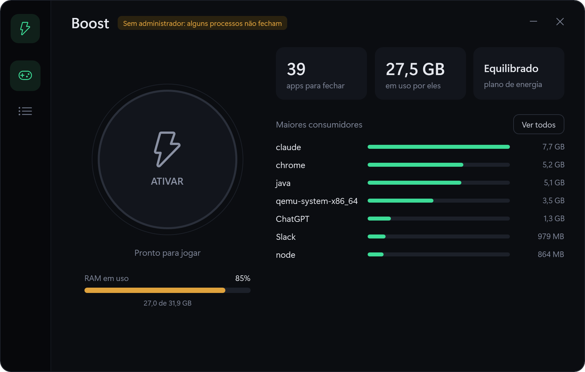
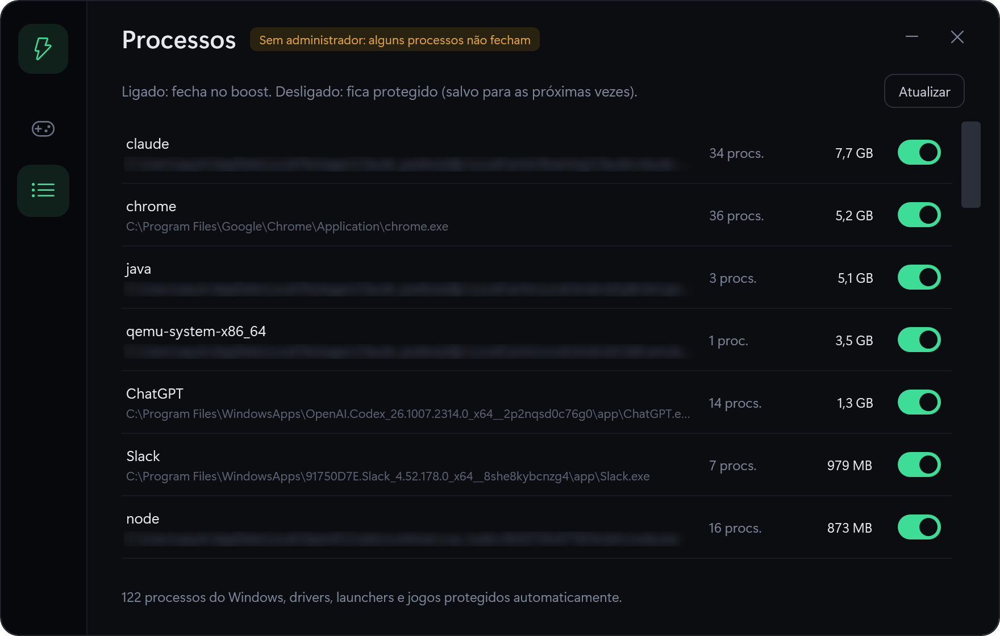

# Modo Game

Um botão para deixar o PC livre antes de jogar. O Modo Game fecha tudo o que não é essencial para o Windows (navegador, Slack, apps de IA, servidores de desenvolvimento, emuladores…) e coloca a energia no máximo. Um segundo clique restaura tudo.



**[⬇️ Baixar o ModoGame.exe (v1.0)](https://github.com/wandercosta/modo-game/releases/latest)** · Windows 10/11 · 56 KB · sem instalador

## Por que fiz

Antes de jogar eu fechava navegador, Slack, apps de IA, emuladores e servidores de desenvolvimento um por um, e sempre esquecia algum consumindo memória. O Modo Game resolve isso com um clique e devolve tudo do jeito que estava quando o jogo acaba.

## Recursos

- **Sem lista fixa:** lê todos os processos da sua sessão, como o Gerenciador de Tarefas, e fecha o que não estiver protegido. Inclusive o que você nem sabia que estava rodando.
- **Fechamento seguro:** primeiro pede para cada app fechar com educação (como clicar no X); o que não fechar em 3 segundos é encerrado à força.
- **Energia máxima:** troca para o plano "Alto desempenho" e volta ao plano anterior ao restaurar.
- **Restauração:** reabre os apps que tinham janela ou que abriram com o Windows, incluindo apps da Microsoft Store (Claude, ChatGPT, Slack).
- **Proteção por app:** na tela Processos, desligue um processo para ele nunca ser fechado. Fica salvo.
- **Leve e nativo:** um único `.exe` de ~56 KB, sem instalador e sem dependências.



## O que nunca é fechado

| Categoria | Exemplos |
|---|---|
| Serviços e outras sessões | Tudo fora da sua sessão de usuário |
| Núcleo do Windows | `dwm`, `explorer`, `csrss`, `ctfmon`, barra de tarefas, qualquer exe em `C:\Windows` |
| Drivers e periféricos | NVIDIA, AMD, Realtek, Razer, Logitech, AJAZZ, SteelSeries, Corsair… |
| Launchers | Hydra, Steam, Epic, Riot, Battle.net, EA, Ubisoft, GOG |
| Jogos | Qualquer processo aberto por um launcher acima |
| Anti-cheat e antivírus | EasyAntiCheat, BattlEye, Vanguard, Defender |

As regras ficam em [`src/Engine.cs`](src/Engine.cs) (`SystemNames`, `KeepPrefixes`, `KeepPathParts`, `Launchers`).

## Como usar

1. [Baixe o `ModoGame.exe`](https://github.com/wandercosta/modo-game/releases/latest) (ou compile, veja abaixo) e dê dois cliques.
2. Na primeira vez, o Windows pode mostrar "O Windows protegeu seu computador". Clique em **Mais informações → Executar assim mesmo** (o exe não tem assinatura digital).
3. Aceite o pedido de administrador. Ele é necessário para fechar todos os processos.
4. Opcional: na tela **Processos**, desligue o que deve continuar aberto (ex.: Discord).
5. Salve seus trabalhos e clique em **ATIVAR**. Para voltar, clique de novo.

> Servidores de desenvolvimento, terminais e emuladores são encerrados e **não** são reabertos. Salve antes de ativar.

## Compilar

Não precisa instalar nada: usa o compilador C# e o .NET Framework 4.8 que já vêm no Windows 10/11.

```powershell
powershell -ExecutionPolicy Bypass -File build.ps1
```

Gera `ModoGame.exe` na raiz. Use `-Teste` para gerar `ModoGame-teste.exe` sem pedir administrador.

### Modos de teste

| Comando | O que faz |
|---|---|
| `ModoGame-teste.exe --listar saida.txt` | Lista o que seria fechado, sem fechar nada |
| `ModoGame-teste.exe --foto tela.png` | Salva um print da interface |

## Estrutura

```
src/
  Engine.cs     varredura de processos, regras de proteção, fechar/restaurar, energia
  Ui.cs         janela WPF e ponto de entrada
  ui.xaml       layout e estilos da interface
  app.manifest  pede administrador e ativa DPI alto
  icon.ps1      gera o ícone
build.ps1       script de compilação
```

Dados do usuário ficam em `%APPDATA%\ModoGame` (`protegidos.txt`, `restaurar.txt`, `energia.txt`, `ativo.txt`).

## Tecnologia

C# 5 + WPF sobre .NET Framework 4.8, compilado com o `csc.exe` nativo do Windows. A interface é carregada de um XAML embutido no exe.
